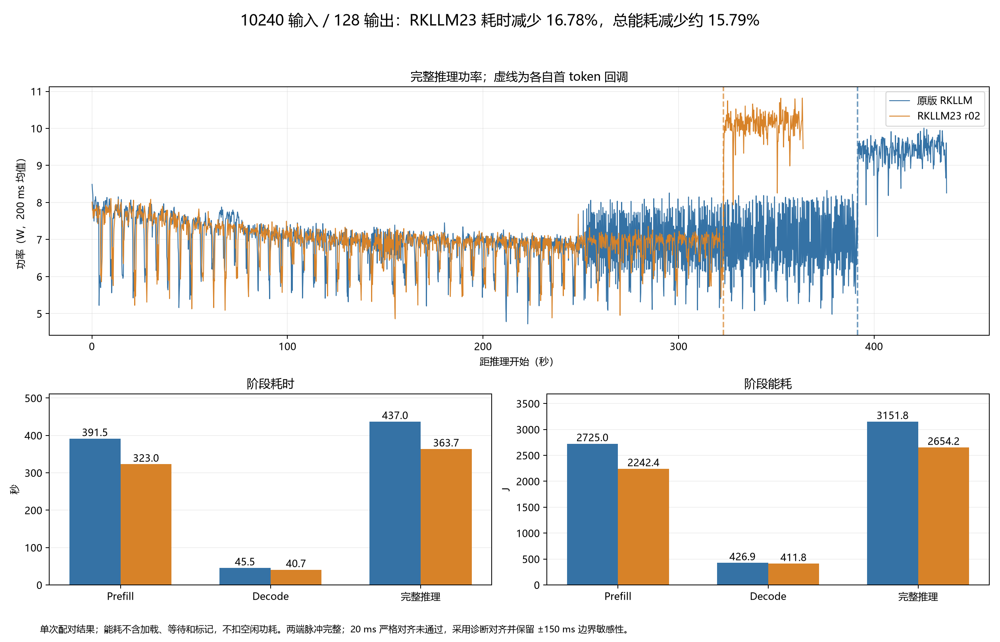
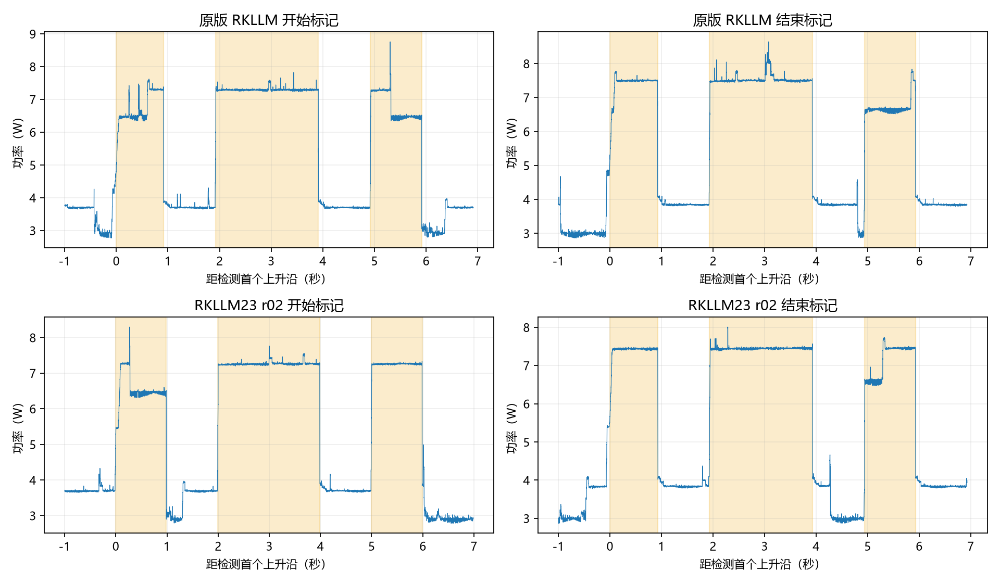

# RKLLM long-context GQA/PV optimization

[English](#english) | [中文](#中文)

<a id="english"></a>

## English

An experimental, process-local adapter for a **hash-pinned RKLLM 1.3.0 Linux AArch64 runtime on RK3588**. It targets selected attention probability-times-value (P×V) operations above KV length 8192. It groups query heads sharing a KV head and splits the reduction dimension into 4096-element blocks.

**This is not a Rockchip release or a replacement implementation of RKLLM.** `v23` is the internal patch revision used in our experiments. The adapter uses a private ABI and an in-memory entry-point trampoline; it is not portable to arbitrary runtime versions. Runtime binaries, SDK headers and model weights are not distributed here.

## Status and measured result

The frozen patch sources are copied byte-for-byte from the tested v23 artifact. The standalone packaging scripts are new; their host-side tests are separate from the historical device measurements. Host checks cover runtime rejection, environment isolation and frozen-source integrity; native board regression of the new wrapper remains pending.

One paired Qwen3.5-4B W8A8 experiment, 10240 input / 128 output tokens, single request with CPU4–7 enabled:

| Metric | Original | Patch v23 r02 | Reduction |
|---|---:|---:|---:|
| Full inference time | 437.03 s | 363.71 s | 16.78% |
| Prefill energy, to first callback | 2724.95 J | 2242.36 J | 17.71% |
| Full inference energy | 3151.84 J | 2654.21 J | approximately 15.79% |

Energy is a **diagnostic estimate** from complete Power-Z records. Both marker pairs are present, but the strict 20 ms alignment check failed. A ±150 ms boundary sensitivity analysis gives 15.64–15.94% total-energy reduction, not a confidence interval or instrument accuracy specification. CPU0 minimum frequency changed from 1800 to 1008 MHz in both runs; identical endpoints do not prove identical trajectories. Do not generalize a single pair to all models or attribute decode differences directly to this prefill patch.



Measurement methods and limitations are included below. The two runs have equal output counts but different output token sequences; semantic equivalence has not been established. The discarded v23 r01 Power-Z recording is not used for total-energy comparison because it lacked the first approximately 50 seconds.

## Algorithm

For each KV head, concatenate its G query heads as rows of one MatMul. Pack the corresponding V block once for those rows, execute FP16 MatMul with FP32 output on the NPU, and sum block outputs in FP32 on the CPU. Full KV history is retained. This is not fused QK/softmax/PV or a full FlashAttention port; it performs CPU packing and accumulation.

The selected model shape is M=64, N=256, H=16, KV heads=4, batch=1, with 1–3 runtime workers. The adapter patches only matching K>8192 shapes up to K=16384. Decode M=1 is not patched. Implementation and compatibility details are included below.

## Requirements

- RK3588 Linux AArch64, native `g++` with C++17 and Python 3.9+.
- User-supplied `rkllm.h`, `rknn_api.h`, `rknn_matmul_api.h` matching the tested SDK/API.
- User-supplied `librkllmrt.so` and `librknnrt.so` matching the `RUNTIME_LOCK` constants in `code/scripts/verify_runtime.py`. Obtain them from the appropriate official distribution. A version string alone is insufficient.
- A compatible Qwen3.5-4B W8A8 RK3588 model and model-matched input token IDs.
- Stop unrelated inference workloads before device tests. The package lock coordinates only this checkout. Adequate cooling is required.

Official dependency entry points: [RKLLM](https://github.com/airockchip/rknn-llm), [RKNN](https://github.com/airockchip/rknn-toolkit2). Their current default branches are not compatibility guarantees. Do not bypass the hash gate for newer libraries.

## Build on the board

Set these paths to SDK files you already obtained; they are placeholders, not files supplied here:

```bash
export SDK_INCLUDE_DIR=/absolute/path/to/sdk/include
export RKLLM_RUNTIME_DIR=/absolute/path/to/pinned/runtime
bash code/scripts/build.sh
```

The script checks both runtime hashes and builds `code/build/libpv_gqa_v23.so`, `code/build/position_worker` and `code/build/pv_gqa_probe`. It does not start inference or change frequency settings. The historical patch binary hash is recorded for provenance; a new compiler build need not have that hash.

## Validate in sequence

First run the standalone numerical/layout probe **on an idle board**, separately for each K:

```bash
LD_LIBRARY_PATH="$RKLLM_RUNTIME_DIR" ./build/pv_gqa_probe 8256
LD_LIBRARY_PATH="$RKLLM_RUNTIME_DIR" ./build/pv_gqa_probe 10240
```

The probe uses deterministic, representable synthetic values and padded tensor strides. Passing does not establish language-model quality. Unlike the model wrapper, the probe has no thermal supervisor; keep these brief tests supervised.

Then prepare a UTF-8 file of whitespace-separated nonnegative token IDs, using the exact tokenizer and chat template for your model. Include template tokens in the requested total. Never reuse token IDs from another model or assume characters equal tokens. Start with 8256 input IDs and 2 output tokens, in separate fresh directories:

```bash
python3 code/scripts/run.py --mode baseline --runtime-dir "$RKLLM_RUNTIME_DIR" --model /path/model.rkllm --input-ids /path/input_8256.txt --out runs/baseline_8256_r01
python3 code/scripts/run.py --mode shadow --runtime-dir "$RKLLM_RUNTIME_DIR" --model /path/model.rkllm --input-ids /path/input_8256.txt --out runs/shadow_8256_r01
python3 code/scripts/run.py --mode tile --runtime-dir "$RKLLM_RUNTIME_DIR" --model /path/model.rkllm --input-ids /path/input_8256.txt --out runs/tile_8256_r01
```

Run commands serially. Inspect each result before proceeding, particularly `RKDUANYADIAN_VERIFY` in `worker.log` and `state` in `run.json`.

- `baseline`: no patch preloaded.
- `shadow`: candidate and original are calculated and compared; the original result is retained. **Not a performance baseline.**
- `tile`: first match per worker thread is compared with the original; later matching calls use the candidate.

After short validation, use the same 10240-ID input file for baseline and tile and add `--output-tokens 128`. The default context is 16384. Both modes use one request, CPU mask 240 (CPU4–7), greedy settings, no KV reuse, and ignore EOS for fixed-output benchmarking. This is not one CPU compute thread. The runner refuses existing output directories, checks counts and hashes, starts below 55°C and terminates at a sampled 85°C threshold or timeout. It never resumes an interrupted inference.

**The new standalone runner is a minimal reproducer, not the full historical energy-capture harness.** It records token callbacks, runtime timing, logs and temperatures. It does not provide Power-Z pulses, five-domain telemetry, operator tracing or the historical post-loading ≤3°C paired-temperature gate. Reproducing the published energy experiment additionally requires those measurement controls; see the measurement methods below.

## Host checks

```bash
python3 -m unittest discover -s code/tests -p 'test_*.py' -v
python3 code/scripts/verify_runtime.py /path/to/runtime
```

Do not preload the adapter directly into an unverified runtime. The opcode guard covers only the entry bytes; full-library verification is provided by the launcher.

## Scope of validation

Successful recorded model runs include short outputs at 10240 and 11264 input tokens, and two 10240→128 patch runs. These are not repeated clean pairs across all lengths. The 11264 run had changing frequency bounds. A prior 10240→512 run was thermally terminated after at least 320 outputs. 12288 and a successful full 10240→5120 GQA run are not claimed here. Numerical thresholds are experimental guards, not proof of semantic equivalence or task quality.


## Implementation and compatibility

## Internal ABI

The adapter finds the loaded `rkllm_init` module, then uses entry offset `0x318dd0`. It checks four original AArch64 words before installing a 16-byte branch stub and trampoline. Tensor data and name offsets are 1776 and 1784. The worker count is read from context offset 8. It assumes 4096-byte executable pages. These details are observations for the pinned build, not a public API contract.

The launcher verifies **both complete runtime files** before running any mode. The in-library opcode guard is not a substitute for those hashes. There is no automatic support for newer RKLLM versions or other AArch64 builds.

## Data path

V is FP16, probabilities and output are FP32. G=H/VH query heads share each KV head. Their query rows become G×M rows in one MatMul. B is packed as `[N/16, K/32, 16, 32]`; the final block is padded to a multiple of 32. Probability rows are converted to FP16, NPU output is FP32, and CPU sums block outputs. Contexts and buffers are cached per thread/shape/core. KV heads are assigned round-robin to workers. There are no governor or frequency writes.

## Matching and failure behavior

The initial predicate tests tensor types, a probability tensor name containing `kq_soft_max`, equal V/P K, K>8192 and M>1. Nonmatches call the original function. For matches, M=64, N=256, H=16, VH=4, batch=1, K≤16384 and 1–3 workers are required. Unsupported matching shapes abort. Invalid/nonparticipating thread indices return without work, following the recovered partition assumption; this is a compatibility risk, not a general scheduler interface.

`shadow` always computes both paths and leaves original output in place. `tile` compares on the first matching invocation of each thread, then writes candidate results. Max absolute error must be ≤0.02, relative RMS ≤0.01, and all values finite. Subsequent calls are not all compared in tile mode. Passing these guards does not establish language-model quality. Output token sequences can diverge after small numeric changes; they must be compared explicitly.

The original source's executable-memory permissions, logging and numerical thresholds are unchanged in this contribution package. It is an experimental private-ABI prototype. Upstream implementation should use maintained internal APIs instead of transplanting this trampoline into a production runtime.

## Inspiration

The investigation referenced llama.cpp's Hexagon backend at commit `bbd488c42abbcf725e7c713bc184eb0ca4a73986`, particularly tiled attention and grouping/reuse ideas. This implementation is RKNN MatMul based; it does not contain a copied Hexagon backend or claim to reproduce Qualcomm's entire attention pipeline. Dependency notices are included below.

## Measurement methods

These are measurements from the existing instrumented experiment harness, **not a new benchmark of the standalone packaging scripts**.

## Device and workload

RK3588, 16 GB RAM, Linux AArch64; Qwen3.5-4B W8A8 RK3588 model; RKLLM 1.3.0 with the pinned runtime pair in `code/scripts/verify_runtime.py`. One request, CPU4–7 enabled, 10240 input tokens including template, 128 actual output callbacks, context16384, greedy configuration, ignore EOS, no retained KV history. This does not mean one compute thread. The full source records remain in the original experiment archive.

The model and original token input file are not bundled. Users must obtain the same model/tokenizer and prepare their own legal input; consequently the out-of-box commands reproduce the method, not the identical historical prompt. Exact prompt-dependent results require the original input asset. Model-file SHA256 and full OS/driver version inventory are not established by this compact evidence export; do not infer them from a model filename or runtime hash.

## Timing and energy

Original run: baseline_original_10240_128_r01. Patched run: rkllm23_10240_128_r02. Both completed 10240/128. Time-to-first-valid-callback defines the energy-stage split; runtime-reported prefill differs slightly. Runtime generate_tokens=127 excludes the first token, while 128 valid NORMAL+WAITING callbacks are counted.

Power-Z measures total input power at the measurement point. Integrate all original 1 ms samples with interpolated boundary samples and trapezoidal integration. No idle subtraction. Loading, waiting and CPU markers are outside the inference interval. No timestamp duplicates, backward timestamps or gaps were found in these files. A direct ENERGY-column delta also agreed closely with the integrated PWR values; both channels come from the same instrument and are not independent calibration.

Start/end markers are CPU-load high1s/idle1s/high2s/idle1s/high1s, with actual worker timestamps and MONOTONIC-to-MONOTONIC_RAW clock brackets. Local 35/50/65% contrast thresholds and 30ms persistence identified rising edges; a two-marker affine clock map was fitted. The original higher-threshold detector could not identify both r02 markers because of stepped edges. Original detections were retained in the experiment archive. Neither run passed the original strict20ms gate. Results use a diagnostic150ms tolerance, not a retrospectively claimed strict pass.

Sensitivity shifts each interval endpoint independently by ±150ms. Full-energy reduction ranges15.64–15.94%. This measures sensitivity to selected alignment perturbations only, not instrument accuracy, clock-map model error, temperature/frequency confounding or statistical confidence. The displayed figure uses200ms means; integrations use all1ms samples.

## Conditions and limitations

Maximum paired start-temperature difference:0.924°C. Maximum temperatures: original79.461°C, v23r02 81.307°C. Both start with the same policy settings; CPU0 min changes1800→1008MHz in each. The timing of those changes is not established by before/after snapshots. The patch itself does not write frequency interfaces.

Both runs used CPU/NPU task tracing plus activity/frequency sampling. The target period was5ms, not a guaranteed interval. For r02, p99 activity interval was8.993ms and maximum63.599ms. Sampling audits remain in the experiment archive. The simpler reproduction runner does not include this instrumentation, so it need not match these times exactly.

Tile performs original-path numerical checking on the first matching operation per thread. r02 checks at K8256 passed: maximum absolute errors around1.19e-6–1.67e-6 and relative RMS around1.12e-7–1.37e-7. This is not a full task-quality evaluation. The archived output ID sequences are different despite equal output counts. These measurements compare fixed-length generation, not identical generated text or established semantic equivalence. Decode differences may include different generated content as well as system state.

One cleanly recorded energy pair is available here. Other recorded patch runs do not replace repeated paired measurements. No claims are made for arbitrary model shapes, all context lengths, a stable5120-token decode, or upstream support. Shadow duplicates computation and is never used as the unpatched timing baseline.




## Dependencies and licensing

- Rockchip RKLLM: https://github.com/airockchip/rknn-llm . Runtime and SDK are externally supplied and governed by their own distribution terms. Repository-level licensing must not be assumed to override every distributed file's notice.
- Rockchip RKNN MatMul API: https://github.com/airockchip/rknn-toolkit2 . The inspected SDK headers carry proprietary notices, so no headers or vendor libraries are redistributed here. Obtain matching files from an authorized distribution and retain their notices.
- llama.cpp Hexagon reference: https://github.com/ggml-org/llama.cpp/tree/bbd488c42abbcf725e7c713bc184eb0ca4a73986/ggml/src/ggml-hexagon . Referenced for tiled attention/GQA reuse concepts. No Hexagon source files are included in this package. Do not describe this as a full FlashAttention or Qualcomm backend port. If code is later imported, include its applicable license and attribution.
- ARM NEON intrinsics are used through the system compiler's `arm_neon.h`, which is not bundled.


No open-source license has yet been selected for the original contributions. The project owner must choose the license and copyright attribution before public release. This statement does not grant a license or relicense vendor dependencies.

---

<a id="中文"></a>

# 中文：RKLLM 长上下文 GQA/PV 优化

[Back to English](#english)

本贡献包研究 RK3588 上特定 RKLLM 1.3.0 运行库在长上下文中的性能突降，并提供已测试补丁的源码、最小运行入口及实验依据。

**v23 是本项目内部补丁编号，不是 Rockchip 官方版本。** 实现通过 `LD_PRELOAD` 加载适配器，改写当前进程内指定函数入口，不覆盖磁盘上的原运行库。它依赖固定哈希、内部 ABI 和函数偏移，不是恢复了 RKLLM 完整源码，也不能直接用于任意运行库。

## 本次整理包含什么

- `code/src/`：冻结的 v23 核心源码，以及模型测试工作进程。核心文件逐字节保留，源码一致性由 `code/tests/test_host.py` 中的冻结哈希校验。
- `code/scripts/build.sh`：在 RK3588 Linux 上原生构建，不自动执行模型。
- `code/scripts/verify_runtime.py`：验证原版 RKLLM/RKNN 两个运行库的 SHA256。
- `code/scripts/run.py`：单轮 baseline/shadow/tile 入口，隔离输出目录，固定单请求 CPU4–7，记录 token 回调及温度，保留超温终止保护。
- `code/tests/`：主机上的启动环境/哈希校验测试，以及板端 GQA 数值与张量步长测试。
- `figures/`：耗时、能耗对比图和 Power-Z 标记对齐图。

没有包含模型权重、官方二进制、SDK 头文件、反汇编文件、手机代码或整个 BDQ 调频项目。原实验文件不受影响。

## 优化方法与边界

对符合条件的 attention P×V 运算，把共享同一个 KV head 的 query heads 合并为 MatMul 的多行，复用一次 V 打包，再沿 K 维按 4096 分块。NPU 计算每块，CPU 做 FP32 累加，保留完整 KV 历史。

它只替换符合条件的 `K>8192` Prefill 路径，当前适配 M=64、N=256、H=16、KV heads=4、batch=1，最多 K=16384、1–3 个内部工作线程。Decode 的 M=1 不替换。不是融合 attention，也不修改 CPU/NPU/DDR 频率。

普通不匹配算子调用原函数；**已经命中候选条件但形状不支持时会终止**。数值不通过、SDK 调用错误或入口指令不匹配也会终止。详细实现与适配限制见下文。

## 已有结果

Qwen3.5-4B W8A8，10240 输入、128 输出，单请求、CPU4–7：

| 指标 | 原版 | v23 r02 | 降幅 |
|---|---:|---:|---:|
| 完整推理耗时 | 437.03 秒 | 363.71 秒 | 16.78% |
| Prefill 能耗 | 2724.95 J | 2242.36 J | 17.71% |
| 完整推理能耗 | 3151.84 J | 2654.21 J | 约 15.79% |


这是一组配对观察，不是多轮统计结论。Power-Z 两端标记完整，但未通过 20 ms 严格对齐，能耗采用诊断对齐；±150 ms 边界敏感性下总节能率约 15.64%–15.94%，不是置信区间。两组 CPU0 最低频率限制均出现 1800→1008 MHz 变化，不能仅凭相同端点就认定频率轨迹一致。Decode 的差异不能直接归因于只修改 Prefill 的补丁。

两组输出数量相同，但输出 token 序列不同，未验证语义等价或模型质量。10240→512 的一次长输出实验因温度保护终止；12288 未验证，不声称 10240→5120 长输出稳定性已通过。这些结果均来自原始实验采集系统。

## 如何构建与运行

这份目录先在电脑本地管理和提交 Git；模型测试在 RK3588 Linux 上运行。需要自行准备匹配哈希的原版运行库、SDK 头文件及模型。不要用当前官网最新文件替换固定依赖后绕过检查。

```bash
export SDK_INCLUDE_DIR=/absolute/path/to/sdk/include
export RKLLM_RUNTIME_DIR=/absolute/path/to/pinned/runtime
bash code/scripts/build.sh
```

头文件目录需要 `rkllm.h`、`rknn_api.h`、`rknn_matmul_api.h`。运行库目录需要 `librkllmrt.so` 与 `librknnrt.so`，哈希固定在 `code/scripts/verify_runtime.py` 的 `RUNTIME_LOCK` 中。

先在空闲开发板运行短数值测试，再串行运行短任务 baseline、shadow、tile。具体命令见 本文件上半部分的英文 “Validate in sequence”。输入文件必须使用本模型的 tokenizer 和聊天模板生成，包含模板后的实际总 token 数；不能把字符数当 token 数。

通过短任务后，再使用同一份 10240-token 输入开展对照：

```bash
python3 code/scripts/run.py --mode baseline --runtime-dir "$RKLLM_RUNTIME_DIR" --model /path/model.rkllm --input-ids /path/input_10240.txt --output-tokens 128 --out runs/baseline_10240_128_r01
python3 code/scripts/run.py --mode tile --runtime-dir "$RKLLM_RUNTIME_DIR" --model /path/model.rkllm --input-ids /path/input_10240.txt --output-tokens 128 --out runs/tile_10240_128_r01
```

两条命令顺序执行，不并行。`shadow` 会重复计算，不用于速度基线。`tile` 每个线程首次命中时比较原结果，此后使用候选结果。`run.json` 与 `long.json` 保留完成状态、计数和计时；失败日志保留，不自动重试。

**这个新入口是最小复现器，不是原始能耗采集系统的完整复制。** 它没有 Power-Z 脉冲、五域遥测、算子 trace，也没有加载后与基线逐传感器温差≤3°C的门限。发布结果来自原实验采集系统；复现能耗需要额外配置相同测量控制。新入口尚未重新进行板端完整回归，不能把原补丁的通过记录当作新打包脚本已验证。

## 实现细节与适用条件

适配器通过 `rkllm_init` 定位运行库，使用固定入口偏移 `0x318dd0`，核对入口的四条 AArch64 指令后安装 16 字节跳转及 trampoline。张量数据和名称偏移分别为 1776、1784，工作线程数量取自上下文偏移 8，并假设可执行页大小为 4096 字节。这些是固定构建的内部布局，不是公开 API；启动器必须先校验两个完整运行库的 SHA256，不能只凭版本字符串或入口指令判断兼容。

V 为 FP16，概率和结果为 FP32。同一 KV head 对应的 G 个 query heads 合并为 G×M 行，V 按 `[N/16, K/32, 16, 32]` 打包，最后一块补齐到 32 的倍数。概率转换为 FP16 后送 NPU，输出 FP32，再由 CPU 累加；上下文及缓存按线程、形状和核心复用。整个过程没有 governor 或频率写入。

初始匹配条件包括张量类型、概率张量名称含 `kq_soft_max`、V/P 的 K 相同、K>8192 和 M>1。命中后要求 M=64、N=256、H=16、KV heads=4、batch=1、K≤16384、内部线程数1–3。非参与线程直接返回的行为依赖恢复出的线程分工假设，不能用于任意调度器。

`shadow` 每次比较两条路径并保留原结果；`tile` 每个线程首次命中时比较，之后不逐次比对。校验要求所有值有限、最大绝对误差≤0.02、相对 RMS≤0.01。数值门限通过不等于语言模型质量通过；本次配对输出从第92个 token 开始出现差异，未建立语义等价结论。

## 测量口径与限制

设备为16 GB RK3588，模型为 Qwen3.5-4B W8A8，context16384，单请求 CPU4–7，贪心生成、忽略 EOS、清空 KV 历史。输入包括模板共10240 token，实际输出128。模型与原始输入文件未随包分发，示例复现方法，不能保证复现相同提示词的精确结果。

能耗按 Power-Z 原始1 ms样本进行梯形积分，边界插值，不扣除空闲功耗；推理区间排除加载、等待及标记。Prefill/Decode 分界取首次有效回调，运行库 generate_tokens=127 不包含首 token。开始和结束均使用高1秒、空闲1秒、高2秒、空闲1秒、高1秒的 CPU 负载标记，采用两端标记仿射时钟对齐。图中功率为200 ms均值，积分仍用原始样本。

两组均未通过原20 ms严格对齐门限；诊断方法使用局部35/50/65%阈值和30 ms持续时间识别上升沿，±150 ms边界扰动仅用于敏感性评估。不能将其解释为仪器精度或统计置信区间。完整 CSV 和 trace 保留在原实验档案中，没有补造缺失采样。

逐传感器最大起始温差0.924°C，原版最高79.461°C，v23最高81.307°C。两组 CPU0 最低频率均变化，起止策略相同不证明轨迹一致。采样目标周期5 ms，v23 r02活动采样间隔p99为8.993 ms、最大63.599 ms。首次K8256数值校验最大绝对误差约1.19e-6–1.67e-6、相对 RMS约1.12e-7–1.37e-7，但不是完整质量测试。

## 依赖、参考与许可

运行库及 SDK 来自 Rockchip RKLLM/RKNN，适用各自分发条款。本包不包含带专有声明的 SDK 头文件、厂商二进制或模型。参考了 llama.cpp Hexagon 后端提交 `bbd488c42abbcf725e7c713bc184eb0ca4a73986` 的分块与 GQA 复用思路，没有附带该后端源码，也不声称完整移植 FlashAttention。相关官方链接见上半部分 Dependencies and licensing。

原创部分的开源许可证和作者署名尚待所有者确定；本次本地整理不授予开源许可，也不改变第三方条款。
